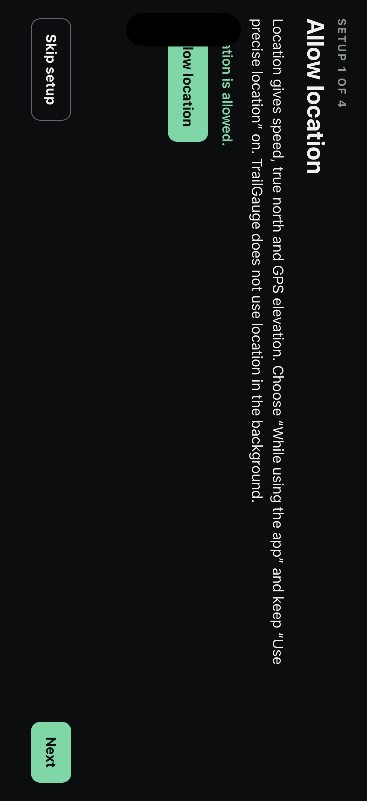

# iOS simulator screenshots

Commit 5b34767, run [44785564023](https://github.com/SethDonohue/trail-gauge/actions/runs/44785564023).
Simulators have no motion sensors, so tilt and compass show `--`; temperatures are demo data.

## 01-iphone

## 02-ipad

