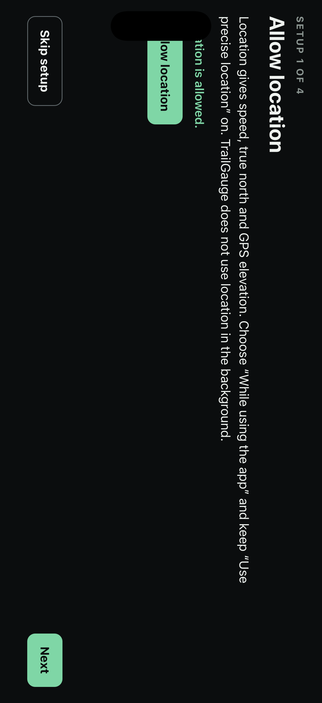

# iOS simulator screenshots

Commit b0603ab, run [43116346237](https://github.com/SethDonohue/trail-gauge/actions/runs/43116346237).
Simulators have no motion sensors, so tilt and compass show `--`; temperatures are demo data.

## 01-iphone

## 02-ipad

